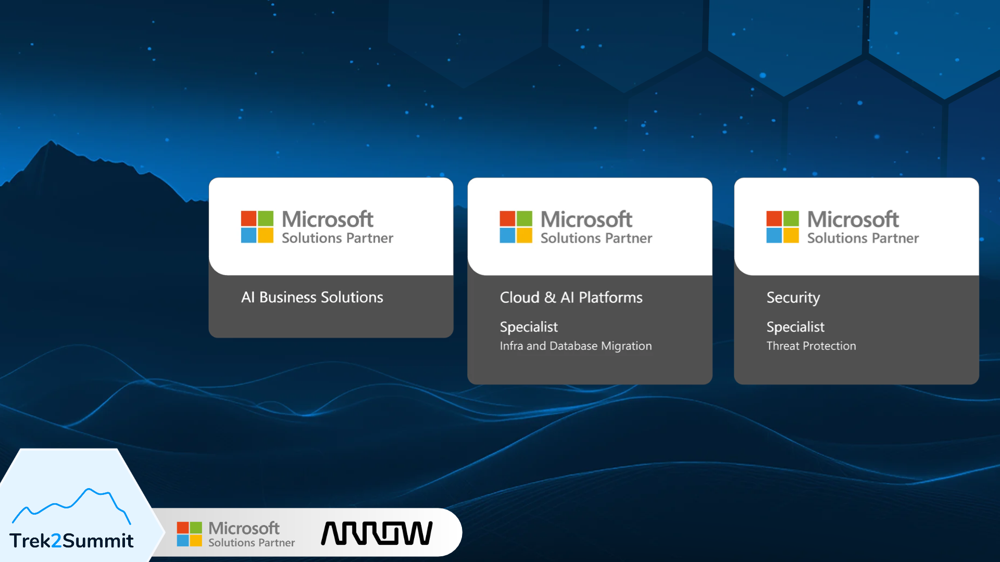
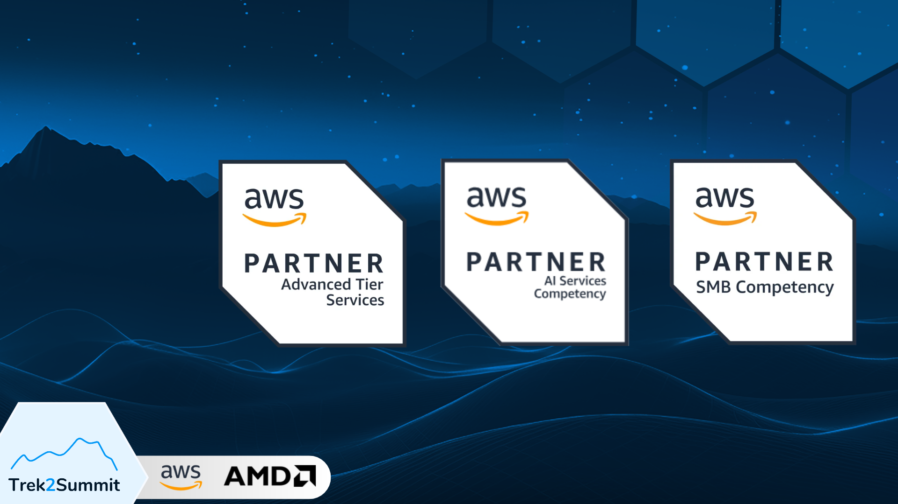
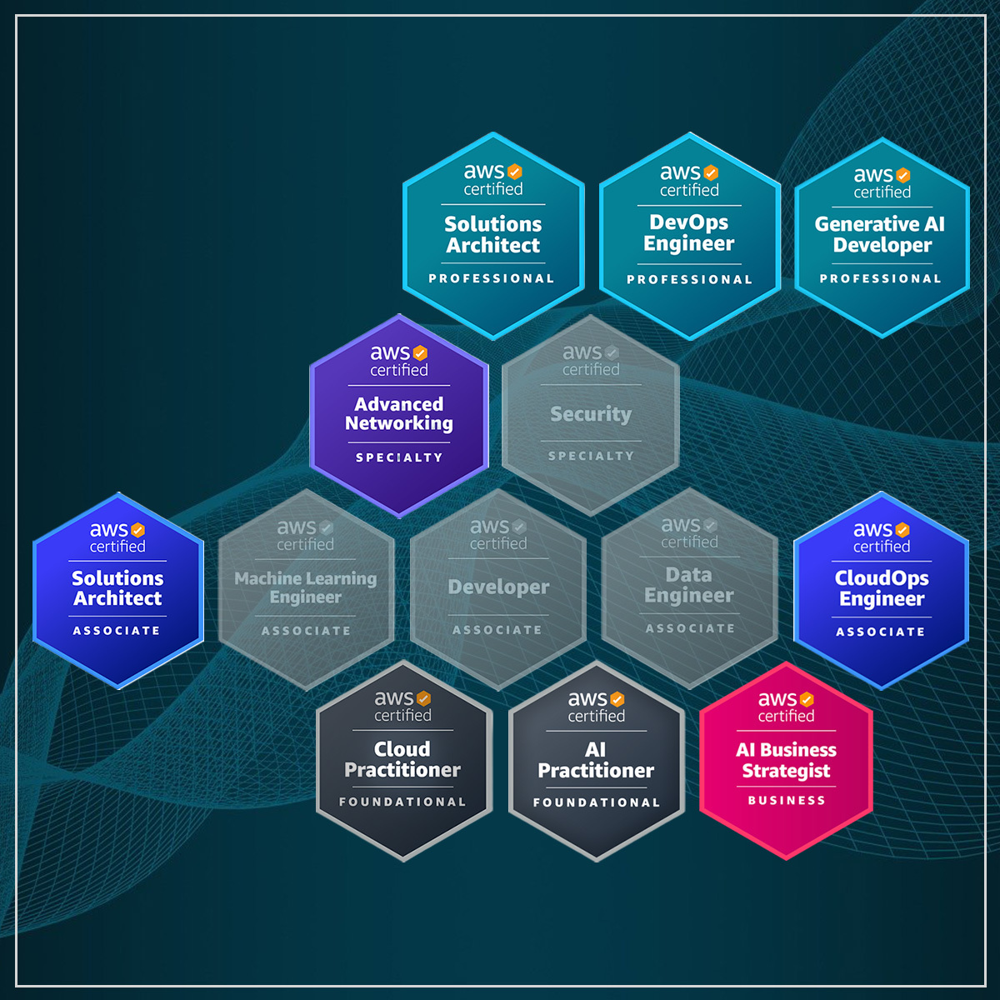

---
theme:
  path: theme.yaml
---

<!-- no_footer -->
<!-- new_lines: 2 -->
<!-- alignment: center -->

# Anyone remember the early days of the public preview of ChatGPT-3?
<!-- pause -->
# Seems like it were only 4 years ago...
<!-- pause -->
<!-- new_lines: 2 -->

<!-- alignment: left -->
# All those crazy ideas we had back then:
<!-- pause -->
<!-- new_lines: 1 -->
Let's fork VS Code and deeply integrate it with AI-assisted coding features
<!-- pause -->
-> Cursor, sold for $60 billion to SpaceX
<!-- pause -->
<!-- new_lines: 1 -->
Let's build a search engine without indexing but with AI
<!-- pause -->
-> Perplexity, in talks with Nvidia at a $30B+ valuation
<!-- pause -->
<!-- new_lines: 1 -->
Let's paste all our proprietary knowledge into Chat-GPT
<!-- pause -->
-> Shadow AI is born
<!-- pause -->
-> Samsung bans AI in early 2023
<!-- pause -->
-> Samsung lifts the ban and launches a full-scale AI Transformation in June 2026
<!-- end_slide -->

<!-- no_footer -->
<!-- new_lines: 2 -->
<!-- alignment: center -->

           ▄▀▀▀▄ ▀█▀    █▀▀▀▄ █▀▀▀▀ █   █ ▀█▀ █   █ █▀▀▀▄           \
           █▄▄▄█  █     █▄▄▄▀ █▄▄▄  █▄▄▄█  █  █▀▄ █ █   █           \
           █   █  █     █   █ █     █   █  █  █  ▀█ █   █           \
           ▀   ▀ ▀▀▀    ▀▀▀▀  ▀▀▀▀▀ ▀   ▀ ▀▀▀ ▀   ▀ ▀▀▀▀            \
                                                                    \
▄▀▀▀▀ █     ▄▀▀▀▄ ▄▀▀▀▀ █▀▀▀▀ █▀▀▀▄    █▀▀▀▄ ▄▀▀▀▄ ▄▀▀▀▄ █▀▀▀▄ ▄▀▀▀▀\
█     █     █   █ ▀▄▄▄  █▄▄▄  █   █    █   █ █   █ █   █ █▄▄▄▀ ▀▄▄▄ \
█     █     █   █     █ █     █   █    █   █ █   █ █   █ █ ▀▄      █\
 ▀▀▀▀ ▀▀▀▀▀  ▀▀▀  ▀▀▀▀  ▀▀▀▀▀ ▀▀▀▀     ▀▀▀▀   ▀▀▀   ▀▀▀  ▀   ▀ ▀▀▀▀ 

<!-- new_lines: 2 -->

What CxOs told us about AI readiness

Rafał Król · Head of AWS Technologies, Trek2Summit

AIBA Conference · Katowice, Ślůnsk · 22 Oct 2026
<!-- end_slide -->

00 · THE WHO

<!-- end_slide -->

00 · THE WHO

<!-- end_slide -->

00 · THE WHO

<!-- column_layout: [1, 1] -->
<!-- column: 0 -->
How it started

<!-- column: 1 -->
How's it going

+ 10+ years working with AWS
+ 10+ AWS exams passed
+ AWS Community Builder
+ DevOpsBoss @ YouTube, Instagram
+ rafalkrol-xyz @ GitHub

<!-- end_slide -->

01 · THE WHAT
<!-- alignment: center -->

What keeps the C-suite up at night?
<!-- new_lines: 1 -->
<!-- pause -->

1. Indirect Corporate Espionage
<!-- pause -->
2. Shadow AI
<!-- pause -->
3. Competitive Obsolescence

<!-- end_slide -->

02 · THE HOW
<!-- alignment: center -->

How we got privy with the CxOs?
<!-- pause -->
<!-- new_lines: 1 -->
Over a dozen AWS AI Assessments this year

(aviation · finance · FMCG · telecom · manufacturing)
<!-- end_slide -->

02 · THE HOW
<!-- alignment: center -->

What's an AWS AI Assessment?
<!-- new_lines: 1 -->
<!-- pause -->

+ Structured engagement, usually done within a calendar month
<!-- pause -->
+ Financed by AWS, for eligible customers
<!-- pause -->
+ Delivered by selected Partners based on their audited competencies and experience
<!-- pause -->

Where AI makes business sense for us,

where it doesn't,

and how to distinguish one from the other?
<!-- end_slide -->

03 · THE WHY
<!-- alignment: center -->

Why would you even need one? Part 1
<!-- new_lines: 1 -->
<!-- pause -->

Inventory, filtering, and prioritization of AI initiatives
<!-- pause -->

via use case discovery, pattern matching, readiness scorecard, architecture roadmap
<!-- pause -->

A cure for the AI noise.
<!-- end_slide -->

03 · THE WHY
<!-- alignment: center -->

Why would you even need one? Part 2
<!-- new_lines: 1 -->
<!-- pause -->

Interest in AI is ubiquitous
<!-- pause -->

However, according to McKinsey’s State of AI 2026 report,

only 37% of organizations attribute a positive EBIT impact.
<!-- pause -->

Calculate Return on Investment (ROI)
<!-- end_slide -->

04 · THE REMEDY
<!-- alignment: center -->
Swap Indirect Corporate Espionage for Zero Data Retention
<!-- pause -->

1. **Amazon Bedrock**: ZDR by default, and operators have no access (ZOA, enforced in hardware)
2. **Azure Foundry**: flagged prompts can be stored and human-reviewed; opting out needs an Enterprise Agreement and Microsoft's approval
3. **Anthropic API**: ZDR only with a dedicated agreement; otherwise 30 days
4. **Gemini Enterprise Agent Platform**: turn off project-level caching, and without an Enterprise Agreement, also opt out of abuse monitoring

There are exceptions, e.g. Anthropic's _Covered models_ (**Claude Mythos** and **Claude Fable 5**) which require a 30-day data retention

<!-- end_slide -->

04 · THE REMEDY
<!-- alignment: center -->
Swap Shadow AI for Governed AI
<!-- pause -->

1. Amazon Quick + Kiro + Bedrock Guardrails + Claude Code with Bedrock
2. Microsoft Copilot + GitHub Copilot (in VS Code) + Purview DLP (Data Loss Prevention) and Sensitivity Labels + Codex with Azure Foundry

Avoid consumer and free tiers as these usually train models with your data
<!-- end_slide -->

04 · THE REMEDY
<!-- alignment: center -->
Swap Competitive Obsolescence for AI Readiness and Adoption
<!-- pause -->
The future is now, old man

The only constant in life is change

Adapt or perish
<!-- pause -->
What a time to be alive
<!-- end_slide -->

<!-- column_layout: [2, 2] -->

<!-- column: 0 -->
Ta muchly!
<!-- new_lines: 2 -->
+ www.trek2summit.com
+ linkedin.com/company/trek2summit
+ linkedin.com/in/rafal-krol
+ kiro.dev
+ github.com/rafalkrol-xyz/ukyo-clicker
+ youtube.com/@DevOpsBoss
+ instagram.com/devopsboss

<!-- column: 1 -->

